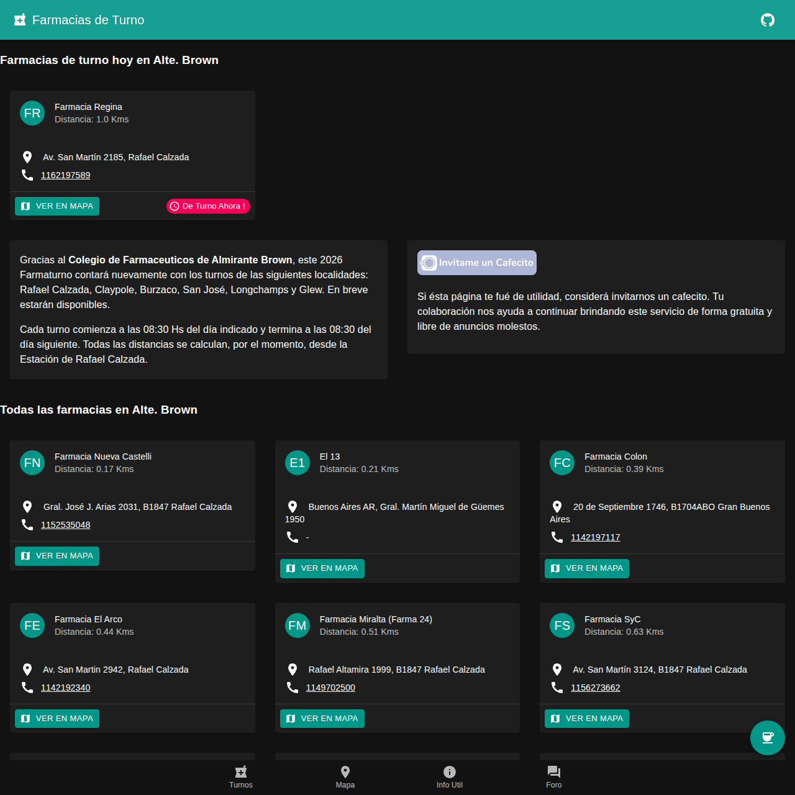

+++
title = "Farmaturno"
description = "Farmacias de turno en el partido de Almirante Brown."
weight = 2

[taxonomies]
tags = ["open-source"]

[extra]
local_image = "projects/farmaturno/farmaturno-com-ar-cover.png"
+++

> **Imaginate esta situación**: Domingo 23:00 hs, llueve. Le tomás la temperatura a tu hija de 4 años y lees 38.5. Abris la heladera y encontrás un Ibuprofeno al 4% vencido. Buscas en las redes y no encontrás qué farmacia está de turno abierta. Salis bajo la lluvia a la farmacia más cercana a tu casa (que obviamente está cerrada) para leer un papel escrito a mano con las farmacias de turno hoy. Intentas memorizar los datos o le sacas una foto y te dirigis a una de las farmacias de la lista para comprar el preciado medicamento.

Esto no es solo una historia. Está basada en hechos reales y es lo que vivi en carne propia en diferentes oportunidades. Farmaturno nació como un intento para resolver esta problemática.

### [Sitio web](https://farmaturno.com.ar) | [Código fuente](https://github.com/MefhigosetH/farmaturno) {.centered-text}

Farmaturno es una página web, gratuita, sin anuncios, con un listado de las farmacias que existen en el partido de Almirante Brown, resaltando aquellas que se encuentan de turno hoy.

También permite ver el listado de farmacias en un mapa, y otra pantalla con un listado de instituciones de salud también del distrito, como por ejemplos salitas, hospitales y CAPs.