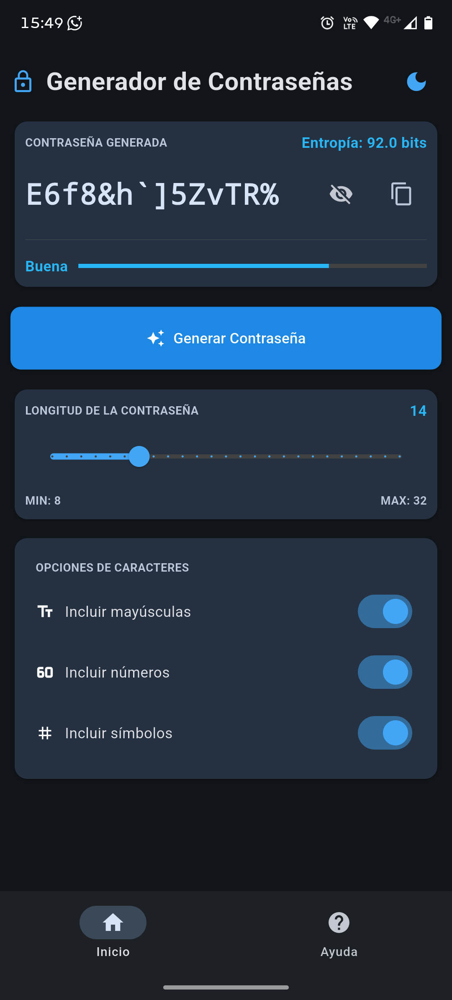

+++
title = "Generador de Contraseñas"
description = "Sencillo, seguro y de códio fuente abierto."
weight = 1

[taxonomies]
tags = ["open-source"]

[extra]
local_image = "projects/password-generator/password-generator-cover.png"
+++

> Un generador de contraseñas propio, abierto y multi-plataforma

Siempre me atrajo la idea del open source porque encaja con mis valores y mi forma de pensar. No me conformo con aprender a usar la tecnología: cuando está a mi alcance, prefiero entender cómo funciona y crearla con mis propios medios.

También me considero un hacktivista, un rebelde digital. No me gusta depender de herramientas cuya construcción desconozco o cuyo tratamiento de mis datos no puedo comprobar. Esa inquietud fue una de las razones por las que decidí crear mi propio generador de contraseñas y compartirlo con otras personas.

### [Código fuente](https://github.com/MefhigosetH/password-generator) {.centered-text}

## De una idea a una aplicación

El resultado es una aplicación para generar contraseñas aleatorias. Permite elegir una longitud de entre 8 y 32 caracteres y activar mayúsculas, números y símbolos. También permite generar una nueva contraseña, copiarla al portapapeles y consultar una estimación de su entropía.

La aplicación está hecha en Python con Flet, que permite construir interfaces usando Python y llevarlas a distintas plataformas. Para la generación utilizo el módulo `secrets` de Python, pensado para obtener valores aleatorios adecuados para usos relacionados con la seguridad.

## Una arquitectura MVC con Fleting

Quería mantener separadas las responsabilidades de la aplicación siguiendo el patrón MVC: el modelo se ocupa de la lógica, la vista de la interfaz y el controlador conecta ambas partes. Esta separación me pareció importante para que el proyecto fuera más claro y fácil de mantener, especialmente al agregar nuevas pantallas.

Para implementar esa estructura utilicé [Fleting](https://alexyucra.github.io/Fleting/), un framework construido sobre Flet que ofrece herramientas para organizar una aplicación con MVC. También me permitió aprovechar el ecosistema de Flet y su flujo de compilación para preparar la aplicación para Android.

## El desafío de mantener la separación

La parte más desafiante fue conservar la separación MVC a medida que la aplicación crecía y sumaba pantallas. En muchos de los ejemplos de la documentación oficial de Flet que consulté, la interfaz y la lógica aparecen juntas. Eso me sirvió para empezar, pero no era la estructura que quería para este proyecto.

Al principio intenté desarrollar la aplicación usando Flet directamente. Cuando quise agregar una segunda pantalla, la de ayuda, no conseguí que la navegación y la estructura MVC funcionaran como esperaba. En lugar de seguir forzando esa solución, busqué una herramienta que resolviera mejor ese problema y decidí incorporar Fleting. Con su estructura y sus herramientas pude organizar las distintas pantallas de una forma más cercana a la arquitectura que quería.

Ese cambio también fue un aprendizaje: elegir un framework no es solo elegir cómo dibujar una interfaz. También importa cómo ayuda a ordenar el proyecto cuando aparecen nuevas necesidades.

## Una nota sobre la fortaleza

La aplicación muestra una estimación de entropía expresada en bits, calculada a partir de la longitud y de los tipos de caracteres que aparecen en la contraseña. Es una referencia útil para comparar configuraciones, pero no es una garantía absoluta de seguridad: el resultado depende de los supuestos del cálculo y no reemplaza las buenas prácticas, como usar contraseñas únicas y guardarlas en un gestor de contraseñas confiable.

## Código abierto y próximos pasos

Compartir el código es parte del propósito del proyecto. Poder leer cómo está construido, plantear mejoras y adaptarlo son algunas de las razones por las que elegí publicarlo como open source.

El código fuente está disponible en [GitHub](https://github.com/MefhigosetH/password-generator). Allí también se pueden consultar las [versiones publicadas](https://github.com/MefhigosetH/password-generator/releases). El proyecto sigue en desarrollo, así que los comentarios, reportes de problemas y contribuciones son bienvenidos.

Si te interesa, puedes explorar el repositorio, probar la aplicación y contarme qué te gustaría ver en futuras versiones.